# 📱 SecureAI Mobile Application (Flutter Android)

[](https://flutter.dev)
[](https://dart.dev)
[%20--%2015%20(API%2035)-3DDC84?logo=android&logoColor=white)](https://developer.android.com)
[](#-supported-android-versions--hardware-specifications)
[](https://secureai-7wgj.onrender.com)

**SecureAI Mobile** is a cross-platform Android security analytics application built using Flutter. It delivers an intelligent defense framework against modern social engineering threats—including Smishing, Quishing (QR Phishing), Email Phishing, Credential Compromises, and Account Takeover Anomalies—directly to mobile users.

The application features a cutting-edge **Liquid Glass interface** with dynamic layering, refractive specular highlights, interactive particle constellations, and 3D elastic button physics synchronized with the SecureAI Web platform.

---

## 📸 Mobile Features & Visual Walkthrough

All 12 core features have been visually tested and verified on physical Android devices and emulators:

<table>
  <tr>
    <td align="center" width="33%">
      <b>1. Public Home Screen</b><br><br>
      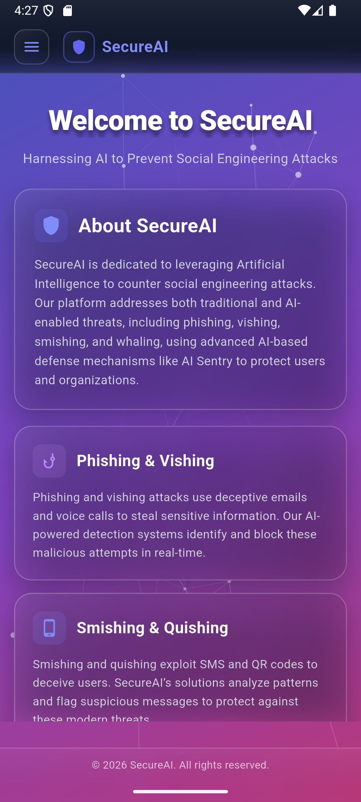<br>
      <i>Clean cosmic landing screen with floating threat cards & particle canvas</i>
    </td>
    <td align="center" width="33%">
      <b>2. Navigation Drawer</b><br><br>
      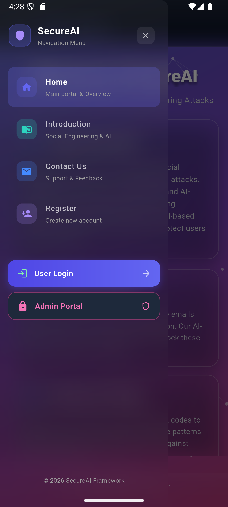<br>
      <i>Frosted liquid glass public slide-out menu with smooth routing</i>
    </td>
    <td align="center" width="33%">
      <b>3. User Login Screen</b><br><br>
      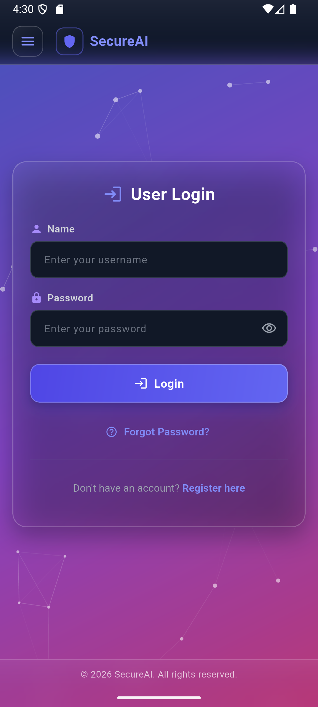<br>
      <i>Translucent login form with floating labels & elastic 3D submit button</i>
    </td>
  </tr>

  <tr>
    <td align="center" width="33%">
      <b>4. Admin Login Portal</b><br><br>
      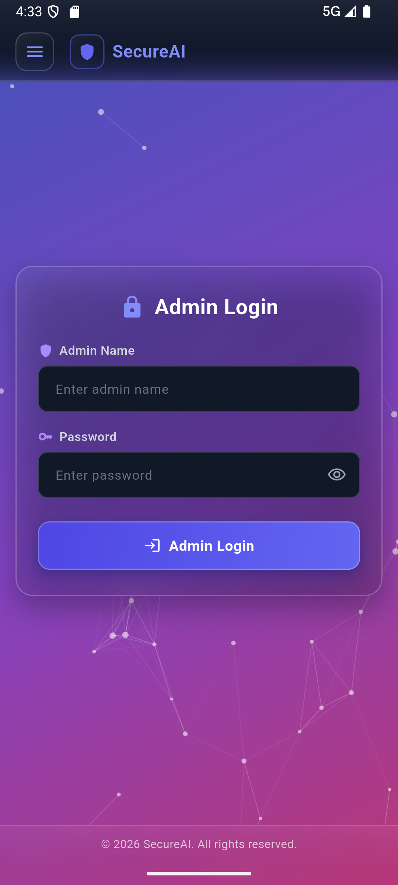<br>
      <i>Secure administrative gateway with shield branding accent</i>
    </td>
    <td align="center" width="33%">
      <b>5. User Dashboard</b><br><br>
      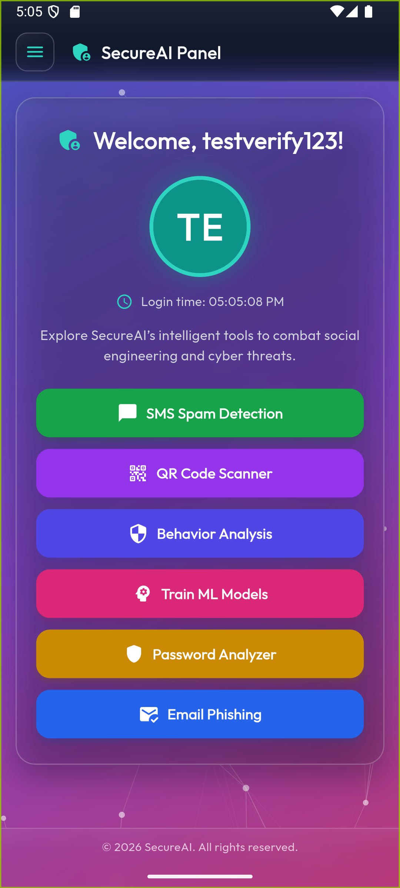<br>
      <i>User dashboard with live clock, profile avatar, and security tools</i>
    </td>
    <td align="center" width="33%">
      <b>6. Admin Dashboard (Users)</b><br><br>
      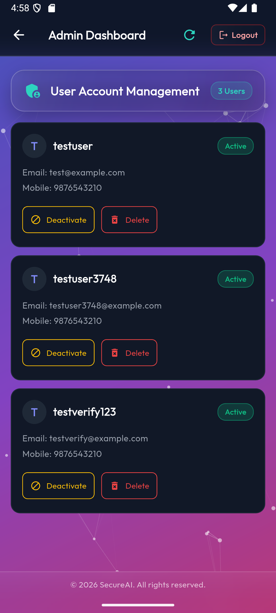<br>
      <i>Live directory with user status badges, Deactivate & Delete controls</i>
    </td>
  </tr>

  <tr>
    <td align="center" width="33%">
      <b>7. SMS Spam Detector</b><br><br>
      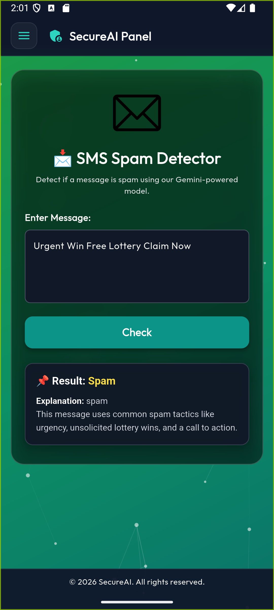<br>
      <i>Real-time NLP classification (Spam / Ham) powered by Google Gemini</i>
    </td>
    <td align="center" width="33%">
      <b>8. Email Phishing Analyzer</b><br><br>
      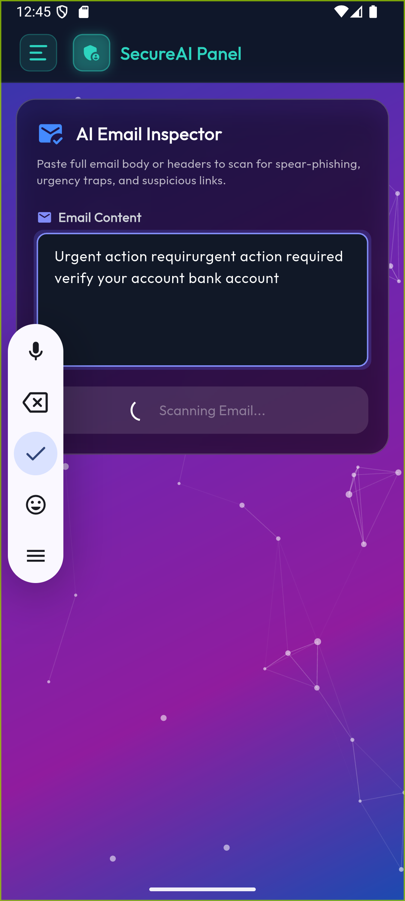<br>
      <i>Deep inspection of urgency, deceptive phrasing & psychological red flags</i>
    </td>
    <td align="center" width="33%">
      <b>9. Password Breach Auditor</b><br><br>
      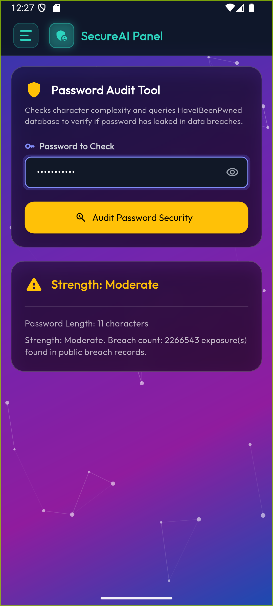<br>
      <i>k-Anonymity SHA-1 lookup checking passwords against billions of breaches</i>
    </td>
  </tr>

  <tr>
    <td align="center" width="33%">
      <b>10. Behavior Anomaly Detection</b><br><br>
      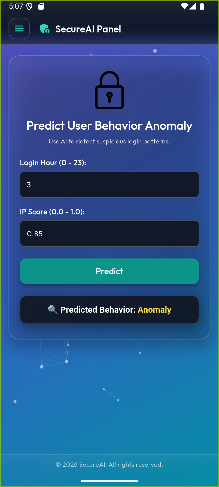<br>
      <i>Evaluates Login Hour & IP Risk Score against trained ML decision boundaries</i>
    </td>
    <td align="center" width="33%">
      <b>11. QR Code Threat Scanner</b><br><br>
      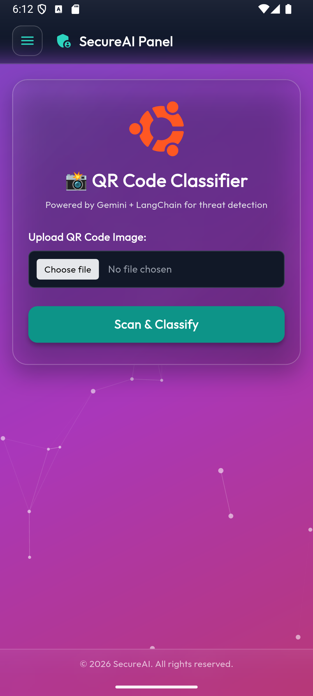<br>
      <i>Gallery upload & camera capture with OpenCV URL threat extraction</i>
    </td>
    <td align="center" width="33%">
      <b>12. Train AI Models (ML Training)</b><br><br>
      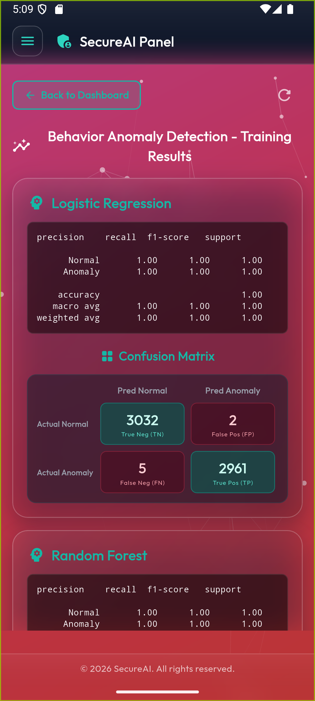<br>
      <i>Interactive ML model retraining displaying metrics & confusion matrices</i>
    </td>
  </tr>
</table>

---

## 🤖 Supported Android Versions & Hardware Specifications

The app is built to ensure maximum compatibility across smartphones and tablets worldwide:

| Parameter | Specification | Details |
| :--- | :--- | :--- |
| **Minimum Android Version** | **Android 5.0 (API Level 21 - Lollipop)** | Supports over 99.4% of active Android devices globally |
| **Target Android Version** | **Android 14 / 15 (API Level 34 / 35)** | Fully optimized for latest Android privacy, storage & edge-to-edge UI |
| **Compile SDK Version** | **API Level 34+** | Built using modern Android Gradle plugins & Kotlin JVM 17 |
| **Supported ABIs (CPUs)** | `arm64-v8a`<br>`armeabi-v7a`<br>`x86_64` | Native 64-bit ARM (modern devices), 32-bit ARM (legacy), and x86_64 (emulators) |
| **Recommended Architecture** | **`arm64-v8a`** | Standard 64-bit binary (~18 MB) offering peak runtime performance |
| **Network Security** | TLS 1.3 / HTTPS + Cleartext | HTTPS for Cloud production (`onrender.com`), Cleartext permitted for local dev (`10.0.2.2`) |

### Android Permissions
Configured inside `android/app/src/main/AndroidManifest.xml`:
- `android.permission.INTERNET`: Communicates with cloud and local security analytics endpoints.
- `android.permission.CAMERA`: Live QR code camera capture.
- `android.permission.READ_EXTERNAL_STORAGE`: Access saved QR code images for analysis.
- `android:usesCleartextTraffic="true"`: Enables local Android emulator testing over `http://10.0.2.2:8000/`.

---

## 🛠️ Technologies & Architectural Stack

### 1. **Framework & Language**
- **Flutter SDK (v3.x)**: Google's reactive UI toolkit.
- **Dart Language (v3.x)**: Sound null-safety, async event handling, and high-performance AOT compilation.

### 2. **Design Language & UI Components**
- **Liquid Glass Design System**: Frosted backdrop filters (`ImageFilter.blur`), linear gradient glass tinting (`rgba(255, 255, 255, 0.12)`), and dynamic layering.
- **Typography**: Google Fonts **Outfit** (`google_fonts`) loaded in light, regular, medium, semi-bold, and bold weights.
- **Constellation Canvas**: Custom painter (`ConstellationBackground`) rendering animated, interactive glowing nodes connected by proximity vectors.
- **Physics-Based 3D Buttons**: `PrimaryButton` and `btn-3d` providing specular edge highlights, gradient depth, and elastic touch feedback.
- **Unified App Bar & Drawer**: `SecureAiAppBar` and `AppDrawer` matching website header and drawer styling with identical routes.

### 3. **Networking, Cloud Sync & Server Wake Protection**
- **Dual Endpoint Architecture**:
  - **Cloud Backend**: `https://secureai-7wgj.onrender.com/` (Production Render service)
  - **Local Fallback**: `http://10.0.2.2:8000/` (Android Emulator loopback to local Django development server)
- **Automatic Server Wake Overlay**: `ServerWakeOverlay` automatically monitors Render cold-start latency (free-tier spin-up), displaying a non-intrusive animated wake status until the server responds.
- **Multipart Form Uploads**: Custom `http.MultipartRequest` pipeline for binary image transmissions (QR Code threat inspection).

### 4. **AI & Security Analysis Engines**
- **Google Gemini 2.5 Flash**: Contextual NLP sequence classification for Smishing and Email Phishing.
- **OpenCV & ZXing QR Decoders**: Matrix extraction and malicious URL pattern extraction.
- **SHA-1 k-Anonymity (HIBP)**: Zero-knowledge password breach checks using 5-character SHA-1 prefix hashing.
- **Machine Learning Classifiers**: Scikit-Learn / XGBoost models analyzing behavioral anomalies (`login_hour`, `ip_score`).

### 5. **Local Session Management**
- `shared_preferences`: Persistent user session handling, login tokens, and role-based access control (Admin vs. Standard User).

---

## 📦 How to Build, Export & Install the Application

### 📋 Prerequisites
1. **Flutter SDK**: Installed and configured in your `PATH` (`flutter --version`).
2. **Android SDK / Android Studio**: Platform tools and SDK build tools for API 34+.
3. **Java Development Kit**: JDK 17 (recommended for Gradle 8+).

---

### 1. Initialize & Install Dependencies
Open your terminal inside the `SecureAI_Mobile_app` directory:
```bash
cd SecureAI_Mobile_app
flutter pub get
```

To verify environment and toolchain readiness:
```bash
flutter doctor
```

---

### 2. Run Locally in Development Mode
Launch on a connected Android phone or Android Studio emulator:
```bash
flutter run
```

---

### 3. Export Release APKs

#### **Option A: Split-per-ABI Release APK (Recommended)**
Generates optimized, architecture-specific APK packages that strip unused native libraries for compact file sizes:
```bash
flutter build apk --split-per-abi
```
Generated APK outputs:
- **`build/app/outputs/flutter-apk/app-arm64-v8a-release.apk`** (**20.2 MB** - Target for modern 64-bit Android smartphones)
- **`build/app/outputs/flutter-apk/app-armeabi-v7a-release.apk`** (**17.7 MB** - Target for older 32-bit legacy devices)
- **`build/app/outputs/flutter-apk/app-x86_64-release.apk`** (**21.7 MB** - Target for Android Studio emulators & ChromeOS)

> [!TIP]
> Both the lightweight **`app-arm64-v8a-release.apk`** (20.2 MB) and universal all-device **`app-release.apk`** (54.3 MB) are hosted on the website and directly downloadable from the navigation bar:
> - Universal APK (All Devices): [https://secureai-7wgj.onrender.com/media/app-release.apk](https://secureai-7wgj.onrender.com/media/app-release.apk)
> - 64-bit v8a APK: [https://secureai-7wgj.onrender.com/media/app-arm64-v8a-release.apk](https://secureai-7wgj.onrender.com/media/app-arm64-v8a-release.apk)

#### **Option B: Universal Fat APK (All Architectures Combined)**
Generates a single self-contained APK compatible with all Android devices (ARMv7, ARM64-v8a, x86_64):
```bash
flutter build apk --release
```
Output:
- `build/app/outputs/flutter-apk/app-release.apk` (~54 MB)

#### **Option C: Google Play Store App Bundle (AAB)**
Generates a signed Android App Bundle ready for Google Play Console distribution:
```bash
flutter build appbundle --release
```
Output:
- `build/app/outputs/bundle/release/app-release.aab`

---

### 4. Install the Exported APK on an Android Device

#### Via USB Debugging (ADB):
Connect your Android phone with Developer Mode & USB Debugging enabled, then run:
```bash
adb install -r build/app/outputs/flutter-apk/app-arm64-v8a-release.apk
```

#### Via Direct Download:
1. Open the SecureAI website in your mobile browser: `https://secureai-7wgj.onrender.com/` (or `http://<your-ip>:8000/`).
2. Tap the **Download APK** button in the top navigation bar.
3. Open the downloaded `app-arm64-v8a-release.apk` on your phone and tap **Install**.

---

## 🔧 Troubleshooting & Tips

- **Render Cold Start**: The first request to the cloud backend may take 20–40 seconds while Render spins up the free-tier container. The app's built-in `ServerWakeOverlay` handles this automatically.
- **Clear Build Artifacts**: If Gradle or Flutter encounters compilation cache conflicts, run:
  ```bash
  flutter clean
  flutter pub get
  ```
- **Local Testing**: To test with your local Django server on an emulator, ensure the Django server is running (`python manage.py runserver 0.0.0.0:8000`) and the app will use `10.0.2.2:8000`.

---

© 2026 SecureAI. All rights reserved.
