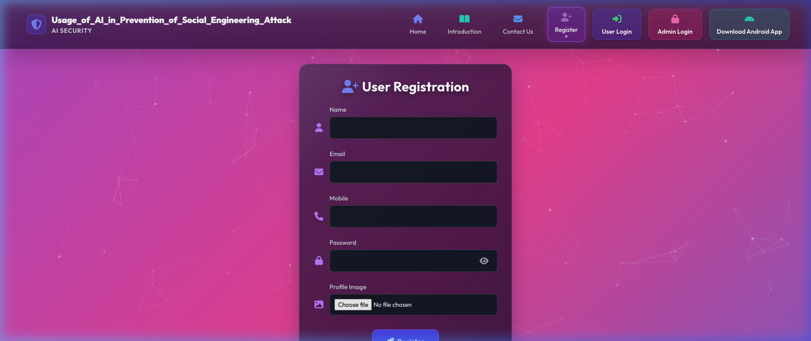
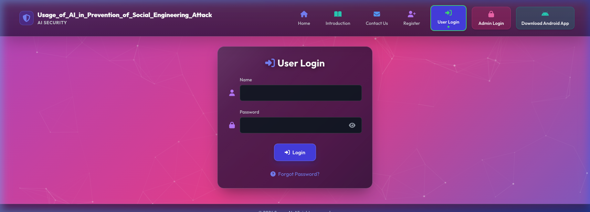
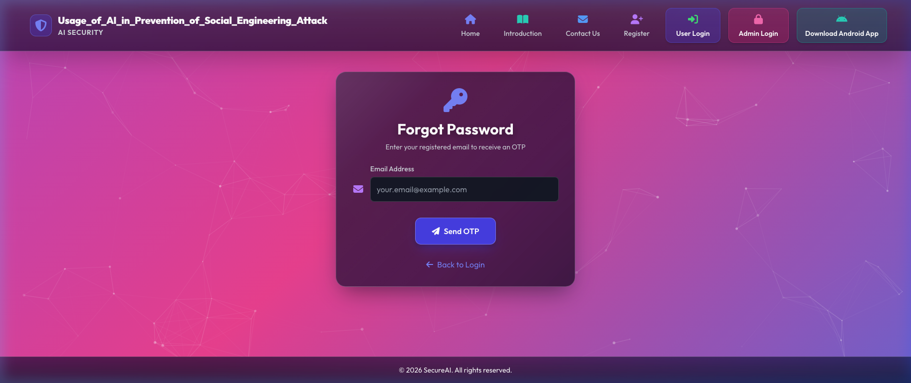
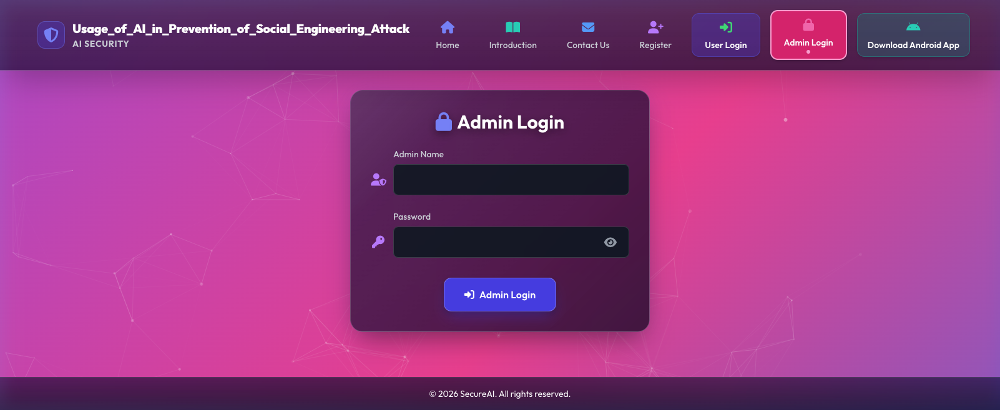
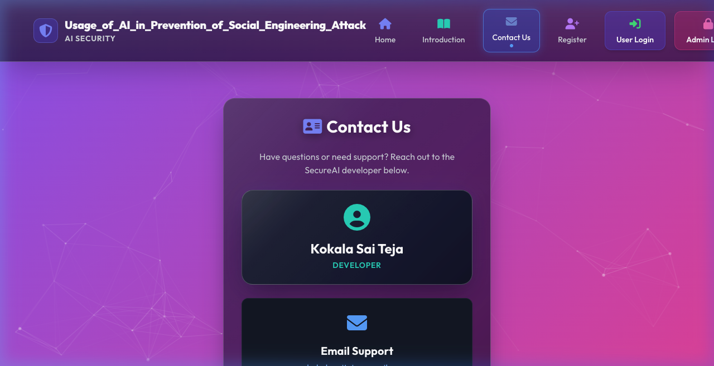

# Social Engineering Attack Prevention System using AI

### 🌐 Live Demo: [https://secureai-7wgj.onrender.com](https://secureai-7wgj.onrender.com)

### 📽 Demo Video Watch the complete working demo here: [SecureAI.mp4](https://www.linkedin.com/posts/sai-teja-kokala-245a12299_ai-cybersecurity-machinelearning-ugcPost-7476167691737714688-QWWw)

An intelligent Django-based security analytics platform designed to analyze social engineering vectors, execute anomaly tracking models, detect malicious communication patterns, and manage interactive admin controls.

## Critical Dependency Warning
> **IMPORTANT:** Running a generic `pip install -r Req.txt` will downgrade essential serialization engines and cause thread-loop failures within the ML training views. Always execute the manual setups below after a generic environment synchronization.

### Required Manual Installations (Core Fixes)

```bash
# 1. Restore serialization engine translation layer for LangChain
pip install --upgrade proto-plus --no-deps --force-reinstall

# 2. Re-establish tracking compatibility for Protocol Buffers
pip install "protobuf>=6.31.1,<8.0.0" --no-deps --force-reinstall
```

### Setup & Local Execution Pipeline

1. **Activate Environment Context:**
```powershell
(Set-ExecutionPolicy -Scope Process -ExecutionPolicy RemoteSigned) ; (& .\venv310\Scripts\Activate.ps1)
```

2. **Launch Development Application:**
```powershell
python manage.py runserver
```

---

## 🚀 Features

### 1. **📩 SMS Spam Detector**
- **Logic**: Natural Language Processing (NLP) tokenization and contextual sequence analysis.
- **Model**: Google Gemini 2.5 Flash AI model.
- **Training Data**: Pre-trained on vast datasets of global SMS communications, encompassing both legitimate messages and known smishing/spam attempts.
- **Functionality**: Real-time classification of SMS messages as **Spam** or **Ham** (not spam), returning a one-line explanation along with the classification.

**How to test (examples):**
- **Example 1 (Spam)**: "Congratulations! You won a free gift. Click to claim now"  
  Expected: **Spam**
- **Example 2 (Ham)**: "Hi! Are we still meeting for dinner tonight?"  
  Expected: **Ham**

### 2. **🔗 QR Code Threat Scanner**
- **Logic**: Image processing to decode QR matrices followed by rigorous URL threat extraction and analysis.
- **Algorithm & Models**: OpenCV for robust QR decoding (handles rotation and blur); LangChain combined with Google Gemini 2.5 Flash for URL threat classification.
- **Training Data**: Analyzes patterns derived from known phishing URLs, safe domain registries, and malicious link structures.
- **Functionality**: Scans QR codes and classifies the hidden URLs as Safe, Phishing, or Malicious.

**How to test (examples):**
- **Example 1 (Safe)**: A QR code linking to a restaurant's digital menu (`https://www.example-restaurant.com/menu`).  
  Expected: **Safe**
- **Example 2 (Phishing)**: A QR code routing to a deceptive banking login page (`http://secure-login-chase-update.com`).  
  Expected: **Phishing / Malicious**

### 3. **📧 Email Phishing Analyzer**
- **Logic**: Textual analysis focusing on psychological triggers associated with social engineering, such as manufactured urgency, false authority, and deceptive phrasing.
- **Model**: Google Gemini 2.5 Flash.
- **Training Data**: Generalized knowledge base encompassing historical phishing templates, scam emails, and standard corporate/personal communications.
- **Functionality**: Evaluates the contents of any suspicious email and returns a strict classification (Safe, Suspicious, Phishing) along with bulleted explanations and identified red flags.

**How to test (examples):**
- **Example 1 (Phishing)**: "Dear customer, your account will be locked in 24 hours. Click here to verify."  
  Expected: **Phishing**
- **Example 2 (Suspicious)**: "Hi team, please find attached the meeting notes from yesterday's sync. Let me know if you have any questions."  
  Expected: **Suspicious**
- **Example 3 (Safe)**: "Hi John, could we reschedule our 1-on-1 meeting to tomorrow at 2 PM? Let me know if that works for you."  
  Expected: **Safe**

### 4. **🛡️ Password Strength & Breach Analyzer**
- **Logic**: Combines heuristic complexity checking with secure, zero-knowledge breach verification.
- **Algorithm**: SHA-1 hashing algorithm for k-Anonymity (prefix matching).
- **Data Source**: Integrates with the "Have I Been Pwned" API database containing billions of leaked credentials.
- **Functionality**: Evaluates password strength (length, uppercase, lowercase, numbers, special characters) and ensures the password has not been exposed in known data breaches without ever transmitting it in plain text.

**How to test (examples):**
- **Example 1 (Weak & Breached)**: `password123`  
  Expected: **Weak Strength & Found in Data Breaches (Unsafe)**
- **Example 2 (Strong & Safe)**: `Tr0ub4dor&3!Secure`  
  Expected: **Strong Strength & No Known Breaches (Safe)**

### 5. **User Behavior Anomaly Detection**
- **Logic**: Statistical profiling and machine learning classification to detect atypical session parameters that may indicate account takeover.
- **Algorithms & Models**: Logistic Regression, Random Forest, and XGBoost classifiers.
- **Training Data**: Trained locally on `behavior_anomaly_dataset.csv`, learning from historical login hours and IP risk scores.
- **Classification Details**: 
  - The models evaluate two primary features: `login_hour` (the time of day the login occurs) and `ip_score` (a probabilistic risk score from 0.0 to 1.0 assigned to the user's IP based on geolocation and reputation).
  - The algorithms create a decision boundary. Combinations of a high `ip_score` (e.g., unknown or risky IP) and an atypical `login_hour` (e.g., 3:00 AM) are flagged as an **Anomaly**. Conversely, standard business hours combined with low IP scores are classified as **Normal**.
- **Functionality**: Real-time prediction of user behavior anomalies. Displays a beautiful HTML/CSS-based confusion matrix heatmap (True Positives, True Negatives, False Positives, False Negatives) for model evaluation, optimized to run without memory-heavy image rendering.

**How to test (examples):**
1. (Optional) Train models first via: **`/train-anomaly-model/`**
2. Go to: **`/predict-anomaly/`**
- **Example 1 (Normal)**: `login_hour=10`, `ip_score=0.20` → Expected **Normal**
- **Example 2 (Anomaly)**: `login_hour=2`, `ip_score=0.95` → Expected **Anomaly**

### 6. **User Management System**
- Secure user registration with admin approval
- Profile image upload
- Password reset with OTP verification
- Session management with login time tracking

### 7. **Admin Dashboard**
- User activation/deactivation controls
- User management interface
- Comprehensive user overview

## 🛠️ Technology Stack

- **Backend**: Django 5.0.9
- **Frontend**: Tailwind CSS, Font Awesome
- **AI/ML**: 
  - Google Gemini 2.5 Flash
  - LangChain
  - Scikit-learn
  - XGBoost
- **Computer Vision**: OpenCV
- **Database**: SQLite (Local Development) & Neon PostgreSQL (Production Deployment)
  > *Deployment Note*: The project uses SQLite for local testing, but it is deployed using [Neon Serverless PostgreSQL](https://console.neon.tech/app/projects/wild-lab-13182754) for persistent production data on Render. Note: while the Neon database is persistent, user-uploaded files on Render's free tier are ephemeral and may reset upon container rebuilds.

## 📋 Prerequisites

- Python 3.10.11
- pip (Python package manager)
- Virtual environment (recommended)

## 🔧 Installation

### 1. Clone the repository
```bash
git clone https://github.com/Kokalasaiteja/SecureAI.git
cd SecureAI/SecureAI_Web
```

### 2. Create and activate virtual environment
> [!IMPORTANT]
> **Avoid `ModuleNotFoundError: No module named 'django'`**: macOS system Python (`/usr/bin/python3`) does not contain Django or ML libraries. Always create and activate your dedicated virtual environment before running management commands.

```bash
# macOS / Linux
python3 -m venv ../.venv
source ../.venv/bin/activate

# Windows (Command Prompt / PowerShell)
python -m venv ..\.venv
..\.venv\Scripts\activate
```

### 3. Install dependencies
```bash
pip install --upgrade pip
pip install -r requirements.txt
```

*(Alternatively: `pip install -r Req.txt`)*

#### 3.1 Optional Generative AI & Voice Packages
If utilizing advanced generative conversational features:
```bash
pip install google-ai-generativelanguage google-generativeai googletrans==4.0.0rc1
pip install langchain langchain-core langchain-google-genai langchain-text-splitters==0.3.8
```

### 4. Configure environment variables
Create a `.env` file in the `SecureAI_Web` directory (or configure in Render Dashboard) with the following environment variables:
```env
SECRET_KEY=your-django-secret-key-here
DEBUG=True
ALLOWED_HOSTS=localhost,127.0.0.1

# Administrator Authentication (Required - No default fallback)
SECUREAI_ADMIN_USERNAME=admin
SECUREAI_ADMIN_PASSWORD=your-strong-admin-password

# Email Gateway & OTP Service (Required for password reset)
RESEND_API_KEY=re_your_resend_api_key_here

# AI / Threat Intelligence
GOOGLE_API_KEY=your-gemini-api-key
```

> [!IMPORTANT]
> **Admin Authentication Security**: Hardcoded administrator credentials have been completely removed. Both `SECUREAI_ADMIN_USERNAME` and `SECUREAI_ADMIN_PASSWORD` must be set in your environment (or Render Environment Settings). If either variable is missing, admin login fails closed with a 503 Service Unavailable error to prevent unauthorized access.

### 5. Run migrations
```bash
python manage.py makemigrations
python manage.py migrate
```

### 6. Create superuser (optional for admin panel)
```bash
python manage.py createsuperuser
```

### 7. Run the development server
```bash
# With virtual environment active:
python manage.py runserver

# Or run directly via virtual environment python binary:
../.venv/bin/python manage.py runserver
```

Visit **`http://127.0.0.1:8000/`** in your browser.

## 🔑 Getting API Keys

### Google Gemini API Key
1. Visit [Google AI Studio](https://makersuite.google.com/app/apikey)
2. Sign in with your Google account
3. Create a new API key
4. Copy the key to your `.env` file

### Resend API Key (for OTP emails)
*Note: Previously, standard Gmail App Passwords were used (`EMAIL_HOST_USER` / `EMAIL_HOST_PASSWORD`). However, cloud environments like Render often block standard SMTP ports (like port 25, 465, 587) resulting in `Network is unreachable` errors. To fix this and provide beautifully formatted HTML emails, we now use the Resend API which operates securely over HTTPS port 443.*
1. Sign up or log in at [Resend](https://resend.com)
2. Navigate to API Keys and generate a new key
3. Copy the key to your `.env` file as `RESEND_API_KEY`

## 📁 Project Structure

```
code/
├── manage.py
├── db.sqlite3                       # SQLite Database (Default)
├── Req.txt                          # Local development requirements (full dependencies)
├── requirements-render.txt          # Render deployment requirements (optimized, no matplotlib/seaborn)
├── .env                             # Local environment configuration file (ignored in git)
├── .gitignore                       # Git ignore configurations
├── README.md                        # Project documentation
├── setup.bat                        # Auto-setup script for Windows
├── setup.sh                         # Auto-setup script for macOS/Linux
├── media/                           # User uploads and ML models
│   ├── models/                      # Trained ML model binaries (.pkl)
│   └── behavior_anomaly_dataset.csv # CSV file for behavioral anomaly training
├── templates/                      # HTML templates
│   ├── base.html
│   ├── home.html
│   ├── register.html
│   ├── user_login.html
│   ├── admin_login.html
│   ├── admin_dashboard.html
│   ├── forgot_password.html
│   ├── verify_otp.html
│   ├── reset_password.html
│   └── users/
│       ├── user_base.html
│       ├── user_homepage.html
│       ├── detect.html
│       ├── qr_form.html
│       ├── qr_result.html
│       ├── predict_anomaly.html
│       └── train_anomaly.html
├── users/                          # Main app codebase
│   ├── models.py
│   ├── views.py
│   ├── admin.py
│   └── migrations/
├── Usage_of_AI_in_Prevention_of_Social_Engineering_Attack/ # Main project configurations
│   ├── settings.py
│   ├── urls.py
│   ├── wsgi.py
│   └── asgi.py
└── yolov5/                          # Local YOLOv5 model configurations
```

## 🎯 Usage

### User Flow
1. **Register**: Create an account with username, email, password, and profile image. The system validates both unique username and email to prevent duplication.
2. **Password Security**: Passwords are automatically hashed with PBKDF2 (`make_password`). Any legacy accounts are automatically and transparently upgraded to PBKDF2 on their first login without interruption.
3. **Wait for Approval**: Admin must activate your account before you can log in.
4. **Login**: Access the user dashboard with your credentials.
5. **Forgot Password**: Password reset with OTP sent via Resend. Features rate-limiting (1 request/60s), 5-minute expiry, and a maximum of 3 verification attempts.
6. **Use Features**:
   - Detect spam messages
   - Scan QR codes for threats
   - Analyze behavioral anomalies

### Admin Flow
1. **Login**: Authenticate using `SECUREAI_ADMIN_USERNAME` and `SECUREAI_ADMIN_PASSWORD` (configured via environment variables or Render dashboard). Uses timing-attack resistant `secrets.compare_digest`.
2. **Dashboard**: View all registered users and database status indicators.
3. **Manage Users**:
   - **Edit User Details**: Edit username, email, active status, and set a new password directly from the Admin Dashboard modal.
   - **Activate / Deactivate Users**: Toggle user access rights.
   - **Delete Users**: Permanently remove user records.

## 🔒 Security Features

- **Environment-based Admin Authentication**: No hardcoded credentials; fails closed with 503 if credentials are unconfigured. Constant-time comparison protects against timing attacks.
- **Enterprise Password Hashing**: PBKDF2 SHA-256 password hashing with automatic transparent migration for legacy plaintext users on login.
- **Duplicate Prevention**: Registration enforces strict uniqueness checks on both `username` and `email` across both web and mobile API endpoints.
- **Hardened OTP Flow**: 60-second rate limiting per email, 5-minute TTL, maximum 3 verification attempts, single-use token consumption, and session-token verified authorization guard before password reset.
- **Session & CSRF Hardening**: 1-hour session lifetime (`SESSION_COOKIE_AGE = 3600`), expire on browser close, HttpOnly cookies, and automatic HTTPS-only secure cookies (`SESSION_COOKIE_SECURE`, `CSRF_COOKIE_SECURE`, `SECURE_PROXY_SSL_HEADER`) in production environments.
- **Admin Access Control**: `@admin_required` server-side authorization protects every administrative endpoint and prevents privilege escalation.
- **Secure File Upload Handling**: Strict image upload validation and storage isolation.

## 🐛 Troubleshooting

### Common Issues

**Issue**: `ModuleNotFoundError`
```bash
# Solution: Install missing packages
pip install -r Req.txt
```

**Issue**: Database errors
```bash
# Solution: Reset database
del db.sqlite3
python manage.py migrate
```

**Issue**: Static files not loading
```bash
# Solution: Collect static files
python manage.py collectstatic
```

**Issue**: Email not sending
- Verify your Resend API Key is correct
- Check your Resend dashboard for delivery logs
- Ensure RESEND_API_KEY is set in .env

## 📊 ML Model Training

To train the behavioral anomaly detection models:

1. Ensure `behavior_anomaly_dataset.csv` is in the `media/` folder
2. Navigate to: User Dashboard → Behavior Analysis → Train Models
3. View confusion matrices and classification reports

## 🎨 UI Features

- Modern glassmorphism design
- Responsive layout (mobile-friendly)
- Animated transitions and hover effects
- Gradient backgrounds
- Icon-based navigation
- 3D button effects

## 📝 API Endpoints

- `/` - Home page
- `/register/` - User registration (enforces unique username and email)
- `/user-login/` - User login (with automatic PBKDF2 password upgrade)
- `/admin-login/` - Admin login (environment variable authenticated)
- `/user-homepage/` - User dashboard
- `/admin-dashboard/` - Admin panel
- `/edit-user/<int:user_id>/` - Admin Edit User (username, email, status, password)
- `/delete-user/<int:user_id>/` - Admin Delete User
- `/toggle-user-status/<int:user_id>/` - Admin Activate/Deactivate User
- `/detect_spam/` - SMS spam detection
- `/scan-qr/` - QR code scanner
- `/predict-anomaly/` - Behavioral analysis
- `/train-anomaly-model/` - Train ML models
- `/forgot-password/` - Password reset request (rate-limited, sends OTP via Resend)
- `/verify-otp/` - OTP verification (3-attempt limit, 5-minute TTL)
- `/reset-password/` - New password setup (strict OTP authorization token required)

# 📸 Screenshots & Application Showcase

<table>
  <tr>
    <td align="center" width="25%">
      <b>Home Page</b><br><br>
      
      <i>Landing page with dynamic liquid glass navigation and direct call-to-action</i>
    </td>
    <td align="center" width="25%">
      <b>Introduction Page</b><br><br>
      
      <i>Security overview with justified responsive typography and threat vectors</i>
    </td>
    <td align="center" width="25%">
      <b>Registration Page</b><br><br>
      <br>
      <i>User sign-up form with aligned input icons and avatar upload</i>
    </td>
    <td align="center" width="25%">
      <b>User Login</b><br><br>
      <br>
      <i>Secure authentication portal with precision-aligned icon fields</i>
    </td>
  </tr>

  <tr>
    <td align="center" width="25%">
      <b>Forgot Password</b><br><br>
      <br>
      <i>Aligned inputs with instant OTP recovery challenge dispatch</i>
    </td>
    <td align="center" width="25%">
      <b>Admin Login</b><br><br>
      <br>
      <i>Administrative access portal with centered eye toggle for password visibility</i>
    </td>
    <td align="center" width="25%">
      <b>Contact Developer</b><br><br>
      <br>
      <i>Updated Developer contact details with responsive liquid glass card</i>
    </td>
    <td align="center" width="25%">
      <b>Admin User Management</b><br><br>
      
      <i>User directory with instant activation, deactivation, and deletion controls</i>
    </td>
  </tr>

  <tr>
    <td align="center" width="25%">
      <b>User Dashboard</b><br><br>
      <br>
      <i>Central security suite with live time, greeting, and analytical tools</i>
    </td>
    <td align="center" width="25%">
      <b>SMS Spam Detector</b><br><br>
      <br>
      <i>Real-time NLP message classification powered by Google Gemini 2.5 Flash</i>
    </td>
    <td align="center" width="25%">
      <b>QR Threat Scanner</b><br><br>
      <br>
      <i>Live camera viewfinder & file upload with OpenCV URL threat extraction</i>
    </td>
    <td align="center" width="25%">
      <b>Behavior Analysis</b><br><br>
      <br>
      <i>Account anomaly detection based on login hour and IP risk profiling</i>
    </td>
  </tr>

  <tr>
    <td align="center" width="25%">
      <b>ML Training Results</b><br><br>
      <br>
      <i>Classification reports and confusion matrix heatmap in liquid glass UI</i>
    </td>
    <td align="center" width="25%">
      <b>Email Phishing Analyzer</b><br><br>
      <br>
      <i>Psychological trigger detection & urgency analysis on incoming emails</i>
    </td>
    <td align="center" width="25%">
      <b>Phishing Analyzer Output</b><br><br>
      <br>
      <i>Verdict breakdown with itemized red flags and classification scores</i>
    </td>
    <td align="center" width="25%">
      <b>Password Breach Checker</b><br><br>
      <br>
      <i>k-Anonymity SHA-1 zero-knowledge audit against breached credentials</i>
    </td>
  </tr>
</table>

## 🤝 Contributing

Contributions are welcome! Please follow these steps:

1. Fork the repository
2. Create a feature branch
3. Commit your changes
4. Push to the branch
5. Open a Pull Request

## 📄 License

This project is licensed under the MIT License.

## 👥 Authors

- Project Team - Usage of AI in Prevention of Social Engineering Attacks

## 🙏 Acknowledgments
- Google Gemini AI for natural language processing
- LangChain for AI orchestration
- Tailwind CSS for modern UI components
- OpenCV for QR code detection
- Scikit-learn and XGBoost for ML models

© 2026 SecureAI. All rights reserved. (SecureAI website)
